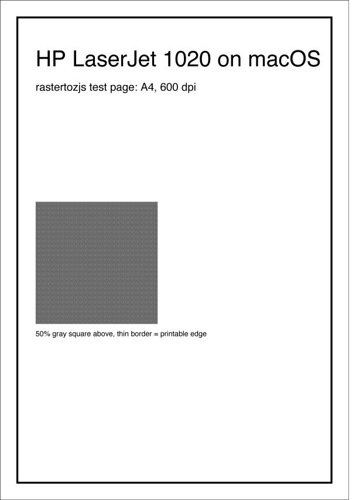

# HP LaserJet 1020 driver for macOS

HP ships no macOS driver for the LaserJet 1020. This one is native: macOS renders each page to 1-bit raster, and `rastertozjs` converts it to the printer's JBIG-compressed ZjStream format. No Ghostscript needed.

The 1020 forgets its firmware whenever it powers off. A launchd job uploads HP's firmware each time the printer appears on USB.



*An A4 test page, decoded back from the data the filter sends to the printer. The thin border is the printable edge.*

## Install

```sh
make                  # builds the filter and downloads HP's firmware (checksum-pinned)
sudo make install     # installs everything and adds the "HP_LaserJet_1020" queue if the printer is connected
```

| Piece | Installed to |
|---|---|
| CUPS filter `rastertozjs` | `/Library/Printers/HP-LJ1020/filter/` |
| PPD | `/Library/Printers/PPDs/Contents/Resources/HP LaserJet 1020.ppd` |
| Firmware | `/Library/Printers/HP-LJ1020/firmware/` |
| Firmware loader | `/Library/Printers/HP-LJ1020/bin/`, `/Library/LaunchDaemons/local.hplj1020.firmware.plist` |

Options: page size (Letter, Legal, Executive, A4, A5, JIS B5, A6, #10, DL, C5, Monarch envelopes) and Toner Saver.

## Printer status

The filter reads the printer's PJL status replies and shows them in the macOS print queue: out of paper, paper jam, door open, no toner, low toner.

After paper runs out, the 1020 stays paused until the host reads its USB device ID. The filter does this every 10 seconds while the printer reports out of paper, so the job resumes once paper is loaded.

Out of paper has been verified on a real printer. Jam and door-open reports, and the automatic resume, are implemented but not yet verified on hardware.

## Troubleshooting

- Jobs finish but nothing prints: the firmware is missing. Run `sudo /Library/Printers/HP-LJ1020/bin/hplj1020-firmware --force`. The log is `/var/log/hplj1020.log`.
- `/usr/libexec/cups/backend/usb` lists the printer with `FWVER:` once firmware is loaded.
- Uninstall: `sudo make uninstall`.

## Sources and licenses

GPL-2.0-or-later (see `LICENSE`).

- ZjStream protocol details for the 1018/1020/1022 come from [foo2zjs](https://github.com/OpenPrinting/foo2zjs).
- `vendor/jbigkit` is jbigkit 2.2 by Markus Kuhn.
- The firmware belongs to HP and is not included. `make` extracts it from HP's HPLIP 3.25.8 plugin, hosted by OpenPrinting.
